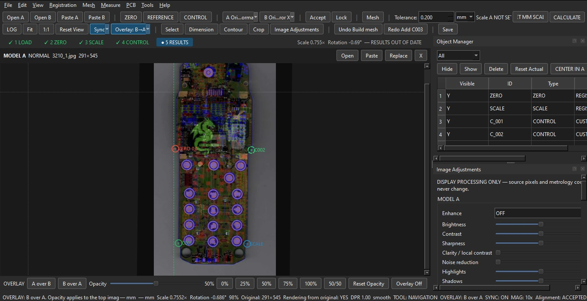
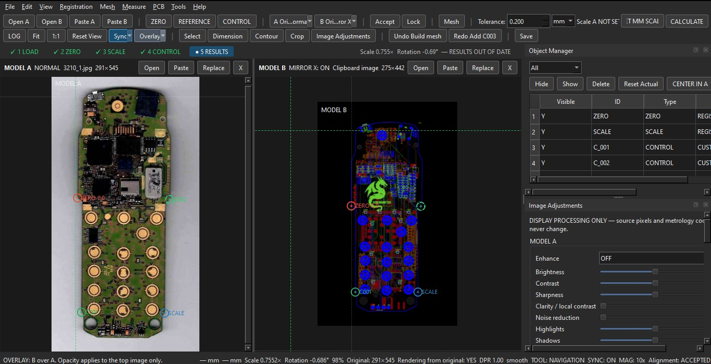

<p align="center">
  
</p>

<h1 align="center">PCB Image Comparator</h1>

<p align="center">A desktop tool for comparing PCB images and helping reproduce original board geometry.</p>

<p align="center"><a href="https://ko-fi.com/jerydgreen"></a></p>

**Developed by Azure Dragon Tech**

## About

## 📸 Screenshots

<p align="center">
  
 
</p>

<p align="center">
  
</p>

PCB Image Comparator was created to help with a practical hardware-development task: transferring the geometry of an original printed circuit board (PCB) into a new design.

The tool helps users compare board images, align and overlay them, inspect details, and work with board contours and component placement. It may be useful for electronics hobbyists, repair projects, and engineers documenting or recreating existing boards.

> **Project status:** The capabilities below reflect the features described by the project. Results depend on input quality and workflow; always verify measurements and exported data before manufacturing a PCB.

## Features

### Image comparison and alignment
- Load images of two boards (Model A and Model B), including normal or mirrored views.
- Overlay images and adjust opacity to compare features.
- Use the built-in magnifier to inspect details.
- Set reference points for zero position, scale, and control-point calibration.

### PCB geometry tools
- Measure dimensions and inspect board contours.
- Work with tolerances when comparing geometry.
- Use available image-enhancement tools such as sharpening and noise reduction.

### Import and export
The project README lists support for:
- **PCB/design and drawing formats:** Gerber, DXF, SVG, KiCad, EasyEDA, Eagle, Excellon, and CSV.
- **Export options:** PDF reports, images, and data tables.

Format support can vary by file type and application version. Verify imported and exported data before relying on it.

### Interface and workflow
- Object Manager and layer tree.
- Undo/redo and change history.
- Workflow controls for common calibration and alignment steps.

## Requirements
- Python 3.13 or newer
- Dependencies listed in `requirements.txt`

## Installation

```bash
git clone https://github.com/jerydgreen-maker/PCB_Image_Comparator.git
cd PCB_Image_Comparator
pip install -r requirements.txt
```

## Run the application

On Windows, try launching `run.bat`, or run the application from a terminal:

```bash
python main.py
```

If the application does not start, confirm that the required Python version is installed and that dependencies installed successfully.

## Typical workflow
1. Load the reference board image and the image you want to compare.
2. Mirror an image if necessary so both views have the same orientation.
3. Align the images using reference points and scale calibration.
4. Adjust overlay opacity and inspect differences.
5. Measure or trace the relevant geometry.
6. Export your work if the required export option is available.
7. Independently verify dimensions and outputs before manufacturing.

## Contributing

Contributions and practical feedback are welcome.

1. Fork this repository.
2. Create a feature branch: `git checkout -b feature/your-feature`
3. Commit your changes: `git commit -m "Describe your change"`
4. Push the branch: `git push origin feature/your-feature`
5. Open a Pull Request.

## Support the project

If this tool is useful to you, you can support independent development on Ko-fi:

**https://ko-fi.com/jerydgreen**

Support helps with continued development, testing, and maintenance.

## Usage and attribution

This project is developed by **Azure Dragon Tech**. Please retain appropriate attribution when sharing or modifying the project.

The repository describes the project as intended for **non-commercial use**. Before redistributing, modifying, or using the software commercially, check the repository's current licensing terms. If no explicit license file is present, permissions may be unclear; the maintainer should add a suitable license defining permitted use.

## Disclaimer

This tool supports image-based PCB comparison and geometry work but does not guarantee manufacturing accuracy. Camera angle, lens distortion, lighting, image scaling, and alignment can affect results. Verify all critical dimensions and generated manufacturing files independently.

---

Made by **Azure Dragon Tech**.
